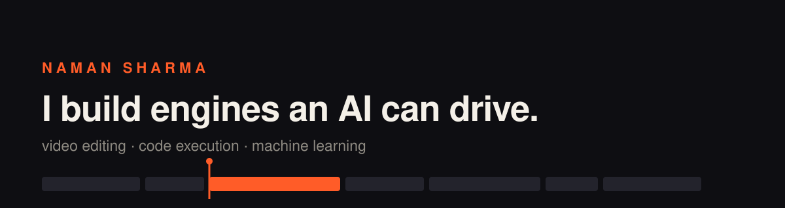

  

I'm a third-year engineering student in India who'd rather build the engine than the app on top of it. Most of my work is systems and creative tooling in Rust, C++ and Python, with an AI agent as the first user.

### Selected work

**[Kimo](https://github.com/naman-sharma12345/kimo)** - a video editor an AI can drive. MCP-first: all 327 features are tool calls, from timeline edits to color science and VFX. Rust core, CPU renderer, runs on a 2 GB box. [getkimo.tech](https://getkimo.tech)

**[AetherRun](https://github.com/naman-sharma12345/code-execution-engine)** - a distributed code execution engine, the same kind of backend that powers LeetCode and Codeforces. Submissions run against hidden tests inside a sandbox and stream results back in real time.

**[Nexel IDE](https://github.com/naman-sharma12345/nexel-ide)** - a minimal code editor for competitive programmers who actually like their tools.

**[SaverAI](https://github.com/naman-sharma12345/saver-ai)** - expense tracking for students, with 7+ on-device ML modules doing forecasting, anomaly detection and budget recommendations. No LLMs, no API keys.

### Elsewhere

Open to AI/ML, backend and SDE internships in Delhi NCR or remote. Reach me at [namanthesharma123@gmail.com](mailto:namanthesharma123@gmail.com) or [LinkedIn](https://www.linkedin.com/in/naman-sharma-66577631a/).
